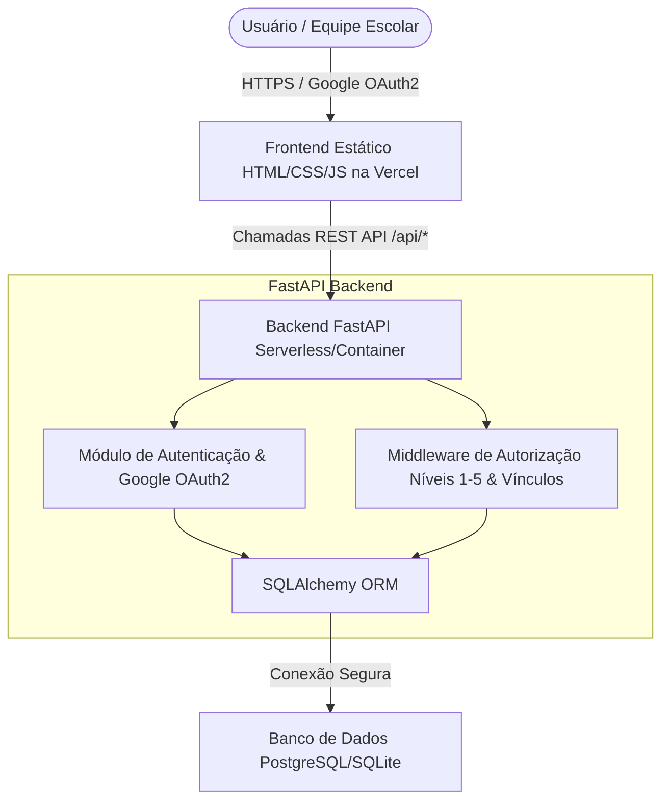
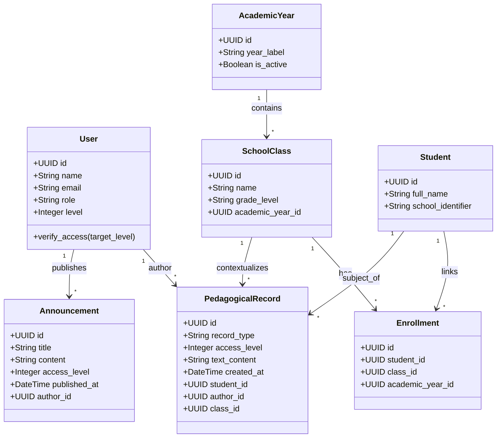

# CompEdu — Arquitetura, Decisões de Produto e Diagramas UML

Este documento consolida as diretrizes arquiteturais, o modelo de segurança, a matriz de acessos e os diagramas estruturais definitivos do sistema **CompEdu**. O conteúdo descreve a aplicação voltada para o ambiente de ensino básico, considerando o deploy em infraestrutura moderna (Vercel) e autenticação federada.

---

## 1. Visão Geral e Escopo

O CompEdu é uma aplicação web voltada para o apoio à gestão escolar, estruturada estritamente em torno de dois pilares operacionais:
1. **Mural Interno de Comunicados:** Canal segmentado de avisos e diretrizes institucionais.
2. **Registros Pedagógicos:** Histórico de acompanhamento evolutivo dos estudantes.

A experiência do usuário é desenhada a partir das tarefas diárias da equipe escolar, abstraindo complexidades técnicas desnecessárias da interface visual.

---

## 2. Matriz de Acessos e Níveis de Permissão (Vertical e Horizontal com Intersecção)

O controle de segurança da plataforma é híbrido e estruturado em duas dimensões complementares:
* **Eixo Vertical (Níveis Numéricos de 1 a 5):** Controla a faixa de sigilo e leitura. O nível `1` é o mais alto. A regra padrão de leitura obedece a $P \ge U$ (o usuário no nível $U$ visualiza conteúdos de nível $P$).
* **Eixo Horizontal (Vínculos e Papéis):** Restringe o escopo de atuação por turmas, ciclos ou atribuições específicas (intersecção organizacional).

### 2.1. Matriz de Papéis Institucionais e Escopo

| Papel (`role`) | Nível Padrão (`level`) | Escopo de Leitura (Vertical: $P \ge U$) | Escopo Horizontal / Restrições de Domínio | Permissões de Escrita / Ações |
| :--- | :---: | :--- | :--- | :--- |
| **Administrador** (`admin`) | `1` (Mais alto) | Vê todos os níveis (1 a 5) | Global (sem restrição de turma). | Gestão completa de cadastros, usuários, turmas e alunos. |
| **Coordenação / Equipe Pedagógica** (`coordination`) | `2` | Vê níveis 2, 3, 4 e 5 | Global ou por ciclo/etapa sob supervisão. **Não recebe acesso padrão aos registros pedagógicos de rotina dos professores**, atuando em nível estratégico e de encaminhamento. | Emissão de relatórios consolidados, comunicados gerais, supervisão e conselho de classe. |
| **Professor** (`teacher`) | `3` (Padrão) | Vê níveis 3, 4 e 5 | Restrito estritamente às **próprias turmas vinculadas** no ano letivo vigente. | Criação e consulta de registros pedagógicos das suas turmas. |
| **Secretaria** (`secretary`) | `4` | Vê níveis 4 e 5 | Administrativo / Operacional (sem acesso pedagógico por padrão). | Gestão de matrículas, calendário escolar e atendimento básico. |
| **Suporte** (`support`) | `5` (Mais restrito) | Vê apenas nível 5 | Técnico / Logs gerais. | Manutenção da infraestrutura e auditoria técnica. |

---

## 3. Arquitetura de Componentes e Deploy

A aplicação utiliza uma arquitetura desacoplada otimizada para o ecossistema Serverless e distribuição via CDN:

---

## 4. Diagrama UML de Classes (Domínio Principal)

O modelo relacional orienta a persistência em SQLAlchemy, garantindo o versionamento anual e o isolamento de registros por nível de acesso e vínculo acadêmico:

---

## 5. Diretrizes Tecnológicas

* **Frontend:** Hospedado na **Vercel** como aplicação SPA leve, integrando-se via requisições assíncronas encapsuladas.
* **Backend:** Desenvolvido em **FastAPI** (Python), provendo contratos limpos validados por Pydantic.
* **Autenticação:** Padronizada em **Google OAuth2**, vinculando o e-mail institucional do usuário ao seu respectivo perfil, papel e nível no banco de dados.