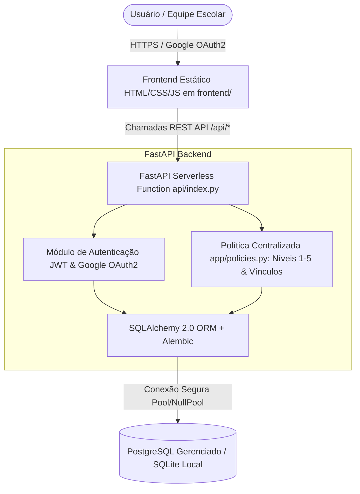
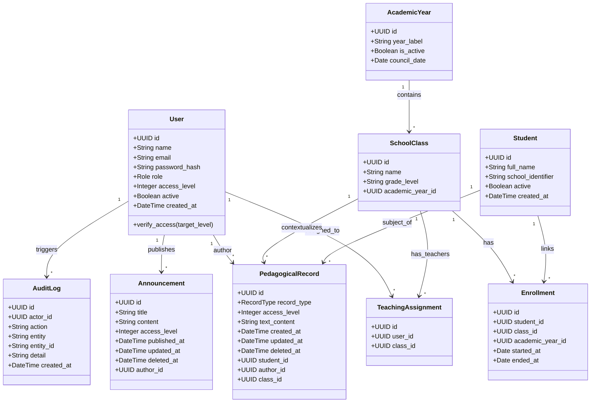

# CompEdu — Arquitetura, Decisões de Produto e Diagramas UML

Este documento consolida as diretrizes arquiteturais, o modelo de segurança, a matriz de acessos e os diagramas estruturais definitivos do sistema **CompEdu**. O conteúdo descreve a aplicação voltada para o ambiente de ensino básico, considerando o deploy em infraestrutura moderna (Vercel) e autenticação federada.

---

## 1. Visão Geral e Escopo

O CompEdu é uma aplicação web voltada para o apoio à gestão escolar, estruturada estritamente em torno de dois pilares operacionais:
1. **Mural Interno de Comunicados:** Canal segmentado de avisos e diretrizes institucionais.
2. **Registros Pedagógicos:** Histórico de acompanhamento evolutivo dos estudantes.

A experiência do usuário é desenhada a partir das tarefas diárias da equipe escolar, abstraindo complexidades técnicas desnecessárias da interface visual.

---

## 2. Matriz de Acessos e Níveis de Permissão (Vertical e Horizontal com Intersecção)

O controle de segurança da plataforma é híbrido e estruturado em duas dimensões complementares, centralizado no módulo `app/policies.py`:
* **Eixo Vertical (Níveis Numéricos de 1 a 5):** Controla a faixa de sigilo e leitura. O nível `1` é o mais alto. A regra padrão de leitura obedece a $P \ge U$ (o usuário no nível $U$ visualiza conteúdos de nível $P$). Nenhum usuário pode publicar um registro ou comunicado em nível numericamente menor ($P < U$) do que o seu próprio nível.
* **Eixo Horizontal (Vínculos e Papéis):** Restringe o escopo de atuação por turmas no ano letivo ativo, ciclos ou atribuições específicas (intersecção organizacional).

### 2.1. Matriz de Papéis Institucionais e Escopo

| Papel (`role`) | Nível Padrão (`level`) | Escopo de Leitura (Vertical: $P \ge U$) | Escopo Horizontal / Restrições de Domínio | Permissões de Escrita / Ações |
| :--- | :---: | :--- | :--- | :--- |
| **Administrador** (`admin`) | `1` (Mais alto) | Vê todos os níveis (1 a 5) | Global (sem restrição de turma). | Gestão completa de cadastros, anos letivos, usuários, vínculos, turmas, alunos e auditoria. |
| **Coordenação / Equipe Pedagógica** (`coordination`) | `2` | Vê níveis 2, 3, 4 e 5 | Global. **Não recebe acesso aos registros pedagógicos de rotina dos professores**, visualizando apenas registros do tipo `follow_up` (acompanhamento/encaminhamento) ou marcados com nível $\le 2$, além dos relatórios consolidados (agregados) de todas as turmas. | Emissão de relatórios consolidados, comunicados gerais, definição da data do conselho de classe e registros de encaminhamento. |
| **Professor** (`teacher`) | `3` (Padrão) | Vê níveis 3, 4 e 5 | Restrito estritamente aos alunos matriculados nas **próprias turmas vinculadas** no ano letivo ativo (além dos registros de própria autoria). | Criação, edição (própria autoria) e consulta de registros pedagógicos e relatório das suas turmas. |
| **Secretaria** (`secretary`) | `4` | Vê níveis 4 e 5 | Administrativo / Operacional (**sem acesso a registros pedagógicos** ou relatórios de turma). | Gestão de cadastro de alunos, matrículas/transferências de turma e publicação de comunicados operacionais. |
| **Suporte** (`support`) | `5` (Mais restrito) | Vê apenas nível 5 | Técnico / Logs gerais (sem acesso a alunos, turmas ou registros pedagógicos). | Consulta da trilha de auditoria técnica (`AuditLog`). |

---

## 3. Arquitetura de Componentes e Deploy

A aplicação utiliza uma arquitetura desacoplada otimizada para o ecossistema Serverless e distribuição via CDN na Vercel:

---

## 4. Diagrama UML de Classes (Domínio Principal)

O modelo relacional implementado em `app/models.py` e versionado via Alembic (`migrations/`) garante o versionamento anual, histórico de matrículas, exclusão lógica e trilha de auditoria:

---

## 5. Diretrizes Tecnológicas e LGPD

* **Frontend:** Servido a partir de `frontend/` na **Vercel** (`outputDirectory: "frontend"`), integrando-se via requisições assíncronas encapsuladas em `frontend/api.js`.
* **Backend:** Desenvolvido em **FastAPI** (Python), exposto em `api/index.py` para funções serverless na Vercel e em `app/main.py` para execução local, com contratos validados por Pydantic.
* **Autenticação:** Padronizada em **Google OAuth2** (`POST /api/auth/google`), validando o `id_token` criptograficamente com `google-auth` (incluindo restrição opcional de domínio `ALLOWED_DOMAIN`) e vinculando o e-mail institucional a um perfil previamente cadastrado e ativo no banco. Para desenvolvimento e testes automatizados, o login local por senha pode ser habilitado via `AUTH_DEV_LOGIN=true`.
* **Proteção de Dados e LGPD (Dados de Menores):**
  * **Princípio do menor privilégio no servidor:** Todas as listagens, contagens do painel e buscas filtram diretamente no SQL via `app/policies.py`. Ocultar elementos na interface é apenas conveniência visual.
  * **Preservação de histórico e exclusão lógica:** Transferências de turma encerram a matrícula anterior (`ended_at`) e abrem uma nova, mantendo os registros pedagógicos vinculados à turma em que ocorreram (`PedagogicalRecord.class_id`). Remoções de registros e comunicados utilizam `deleted_at` (soft delete).
  * **Trilha de auditoria sem vazamento:** A tabela `AuditLog` registra quem executou cada operação (`actor_id`, `action`, `entity`, `entity_id`, `created_at`), sem duplicar o conteúdo textual sensível dos registros pedagógicos, permitindo que a equipe de suporte audite a infraestrutura sem acessar dados de estudantes.
