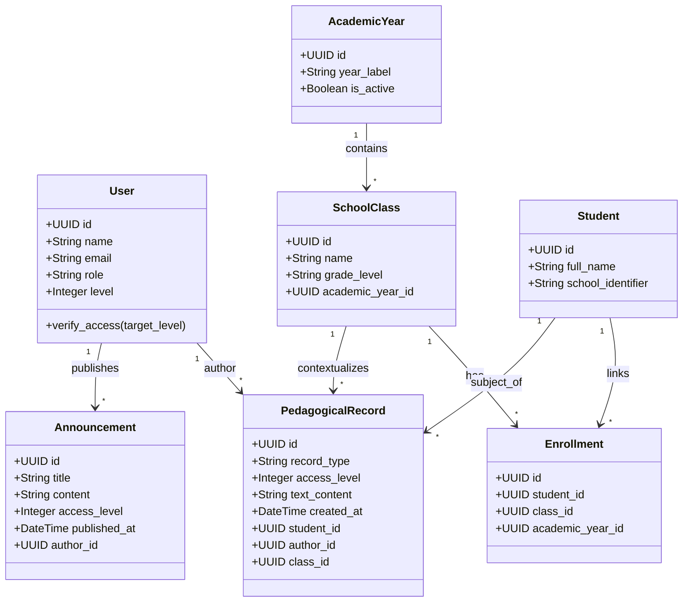

# CompEdu — Arquitetura, Decisões de Produto e Diagramas UML

Este documento consolida as diretrizes arquiteturais, o modelo de segurança, a matriz de acessos e os diagramas estruturais definitivos do sistema **CompEdu**. O conteúdo descreve a aplicação voltada para o ambiente de ensino básico, considerando o deploy em infraestrutura moderna (Vercel) e autenticação federada.

---

## 1. Visão Geral e Escopo

O CompEdu é uma aplicação web voltada para o apoio à gestão escolar, estruturada estritamente em torno de dois pilares operacionais:
1. **Mural Interno de Comunicados:** Canal segmentado de avisos e diretrizes institucionais.
2. **Registros Pedagógicos:** Histórico de acompanhamento evolutivo dos estudantes.

A experiência do usuário é desenhada a partir das tarefas diárias da equipe escolar, abstraindo complexidades técnicas desnecessárias da interface visual.

---

## 2. Matriz de Acessos e Níveis de Permissão

O controle de segurança da plataforma é híbrido, combinando **Papéis de Usuário (`role`)** e uma **Escala Numérica de Nível de Acesso (1 a 5)**.

### 2.1. Regra de Níveis Numéricos (1 a 5)
* O número `1` representa o nível hierárquico mais alto.
* **Regra de Visualização ($P \ge U$):** Um usuário posicionado no nível $U$ possui permissão para visualizar conteúdos marcados com o nível $P$ se, e somente se, $P \ge U$ (por exemplo, um usuário de nível 2 visualiza conteúdos dos níveis 2, 3, 4 e 5).
* **Restrição de Criação:** Nenhum usuário pode criar publicações ou registros em um nível de acesso numericamente superior ao seu próprio nível hierárquico.

### 2.2. Matriz de Papéis Institucionais

| Papel (`role`) | Nível Padrão (`level`) | Escopo de Leitura (Regra: $P \ge U$) | Permissões Principais de Escrita / Ações |
| :--- | :---: | :--- | :--- |
| **Administrador** (`admin`) | `1` (Mais alto) | Vê todos os níveis (1 a 5) | Gestão completa de cadastros (turmas, alunos, usuários). |
| **Coordenação** (`coordination`) | `2` | Vê níveis 2, 3, 4 e 5 | Emissão de relatórios consolidados, comunicados gerais, supervisão. |
| **Professor** (`teacher`) | `3` (Padrão) | Vê níveis 3, 4 e 5 | Criação de registros pedagógicos (restrito às próprias turmas vinculadas). |
| **Secretaria** (`secretary`) | `4` | Vê níveis 4 e 5 | Gestão administrativa, calendário e suporte operacional. |
| **Suporte** (`support`) | `5` (Mais restrito) | Vê apenas nível 5 | Manutenção técnica e logs gerais de infraestrutura. |

---

## 3. Arquitetura de Componentes e Deploy

A aplicação utiliza uma arquitetura desacoplada otimizada para o ecossistema Serverless e distribuição via CDN:

```mermaid
graph TD
    User([Usuário / Equipe Escolar]) -->|HTTPS / Google OAuth2| Vercel[Frontend Estático (HTML/CSS/JS) na Vercel]
    Vercel -->|Chamadas REST API /api/*| FastAPI[Backend FastAPI (Serverless / Container)]
    
    subgraph FastAPI Backend
        FastAPI --> Auth[Módulo de Autenticação & Google OAuth2]
        FastAPI --> RBAC[Middleware de Autorização (Níveis 1-5 & Vínculos)]
        Auth --> ORM[SQLAlchemy ORM]
        RBAC --> ORM
    end

    ORM -->|Conexão Segura| DB[(Banco de Dados PostgreSQL / SQLite)]
```

---

## 4. Diagrama UML de Classes (Domínio Principal)

O modelo relacional orienta a persistência em SQLAlchemy, garantindo o versionamento anual e o isolamento de registros por nível de acesso e vínculo acadêmico:



---

## 5. Diretrizes Tecnológicas

* **Frontend:** Hospedado na **Vercel** como aplicação SPA leve, integrando-se via requisições assíncronas encapsuladas.
* **Backend:** Desenvolvido em **FastAPI** (Python), provendo contratos limpos validados por Pydantic.
* **Autenticação:** Padronizada em **Google OAuth2**, vinculando o e-mail institucional do usuário ao seu respectivo perfil, papel e nível no banco de dados.